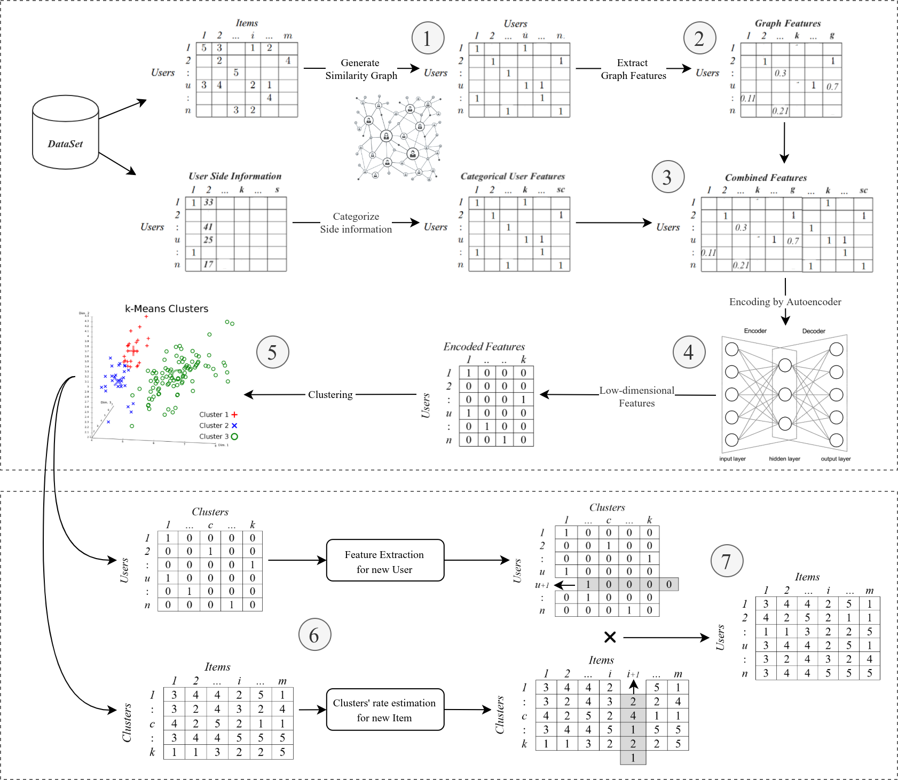

# GHRS reproduction on MovieLens 100K

This repository reimplements and evaluates **GHRS**, the graph-based hybrid recommender
system of Darban & Valipour (2022), on the MovieLens 100K dataset, as part of a Master's
project. Phase 1 reproduces the paper and builds a clean baseline. Phase 2 extends the
method with a variational autoencoder, a TF-IDF genre condition on the user graph and
soft clustering (Gaussian mixtures and fuzzy c-means).

The authors published only the feature extraction step
([hadoov/GHRS](https://github.com/hadoov/GHRS)). The remaining steps (autoencoder,
clustering and rating prediction) are rebuilt here from the paper.



## Method

GHRS predicts ratings in seven steps:

1. Build a user similarity graph: two users are connected if they gave the same rating
   to at least `alpha * 1682` movies.
2. Compute six centrality measures for every user (PageRank, degree, closeness,
   betweenness, load, average neighbour degree).
3. Add one-hot demographic features (age group, gender, occupation), giving 35
   features per user.
4. Compress the features to 4 dimensions with an autoencoder (35-16-4-16-35).
5. Cluster the users with K-Means (K = 8).
6. Fill a cluster x movie matrix with average ratings (Algorithm 1 of the paper).
7. Predict a user's rating as the value for that user's cluster.

## Results

5-fold cross-validation on the standard splits `u1`-`u5`, alpha = 0.01, K = 8,
averaged over 5 random seeds:

| Model                          |          RMSE | Precision | Recall |
| ------------------------------ | ------------: | --------: | -----: |
| GHRS, as reported in the paper |         0.887 |     0.771 |  0.799 |
| GHRS, this implementation      | 1.076 ± 0.001 |     0.664 |  0.724 |
| Item mean (reference)          |         1.025 |           |        |
| Global mean (reference)        |         1.126 |           |        |

The reported RMSE could not be reproduced. A tuning search over the settings the paper
does not specify, a search over user partitions, and a set of simulated evaluation
mistakes all fail to explain the gap. The details are in
[docs/phase1_reproducibility_audit.md](docs/phase1_reproducibility_audit.md).

### Phase 2: Our Contributions

Same folds and seeds, K = 8. p-values: corrected resampled t-test on the per-fold RMSE,
Holm-adjusted. The full tables, controls, cold-start results and sweeps are produced
by `scripts/run_phase2.py` in [docs/phase2_results_report.md](docs/phase2_results_report.md),
and the figures for the paper in [`figs/`](figs/).

| Model                           |   RMSE |         vs baseline | Notes                                         |
| ------------------------------- | -----: | ------------------: | --------------------------------------------- |
| Phase 1 baseline (AE + K-Means) | 1.0761 |                     | Reproduction of the paper's pipeline          |
| VAE + K-Means                   | 1.0788 |             +0.0028 | Generative representation; no gain            |
| TF-IDF graph + AE + K-Means     | 1.0777 |             +0.0016 | Genre-aware graph; no gain                    |
| AE + GMM                        | 1.0727 |  -0.0034 (p = 0.15) | Soft clustering; not significant              |
| VAE + GMM                       | 1.0657 |  -0.0103 (p = 0.02) | Generative representation + soft clustering   |
| AE + FCM                        | 1.0263 | -0.0497 (p < 0.001) | Soft clustering; better in 5/5 folds          |
| VAE + FCM + TF-IDF              | 1.0255 | -0.0505 (p < 0.001) | All three contributions; better in 5/5 folds  |

Soft clustering with fuzzy c-means lowers the RMSE by about 0.05 compared with the
baseline, with similar gains for cold-start users. The controls show where the gain comes
from. The same FCM partitions used as hard labels score like the baseline. RMSE falls
steadily as the memberships get softer, and the best soft variants reach the level of
GHRS with a single cluster (item means). So the gain comes from averaging over clusters
rather than from a better user partition. The VAE and the TF-IDF graph condition do not
change the RMSE on their own; the TF-IDF graph scores the same as a graph with the same
number of randomly kept edges.

### Phase 3: Synthesis with SVD++

R. Jarzyński's parallel reproduction showed that the largest gain comes from user and
item biases and from factorisation. We added his SVD++ model with the GHRS features as
side information, a per-user temporal split and a label-permutation leakage audit, and
ran our soft clustering on top of SVD++ as a residual correction.

| Model                               | 5-fold RMSE | Temporal (per user) | Notes                                   |
| ----------------------------------- | ----------: | ------------------: | --------------------------------------- |
| GHRS reproduction (AE + K-Means)    |      1.0761 |              1.1339 | Phase 1                                 |
| SVD++ with GHRS features            |      0.9080 |              0.9547 | 0.168 better than GHRS, 5/5 folds       |
| SVD++ + FCM residual                |      0.9075 |              0.9535 | -0.0006 vs SVD++, 5/5 folds (p = 0.04)  |
| SVD++ + VAE + FCM + TF-IDF residual |      0.9073 |              0.9534 | -0.0007 vs SVD++, 5/5 folds (p = 0.06)  |

Details: [docs/final_synthesis_report.md](docs/final_synthesis_report.md) and
[docs/phase3_synthesis_results.md](docs/phase3_synthesis_results.md). The synthesis
script also draws the main comparison `figs/fig1_rmse_comparison` and
`figs/fig4_temporal_robustness` for the defence slides (labelled in Polish).

## Repository structure

```
ghrs/                     the method as a Python package
  data.py                 MovieLens 100K loaders
  features.py             steps 1-3: similarity graph, centralities, side information
  autoencoder.py          step 4: autoencoder
  clustering.py           step 5: K-Means and choice of K
  recommender.py          steps 6-7: cluster-item ratings and predictions
  metrics.py              RMSE, MAE, precision and recall
  experiment.py           shared pipeline, evaluation protocols and caching
  paths.py                repository locations used as defaults
  tables.py               aligned Markdown tables for the reports
  bounds.py               best RMSE reachable by any user partition
  autoencoder_vae.py      Phase 2: variational autoencoder (step 4)
  graph_tfidf.py          Phase 2: graph with a TF-IDF genre condition (step 1)
  clustering_soft.py      Phase 2: GMM and fuzzy c-means memberships (step 5)
  figures.py              figures: dataset overview, Phase 2 (RMSE, fuzzifier, K), Phase 3 (synthesis, temporal split)
  factorization.py        Phase 3: SVD++ with GHRS side information
  stats.py                corrected resampled t-test and Holm adjustment
scripts/                  command-line entry points
  build_features_100k.py  the authors' feature script, updated for current libraries
  verify_features.py      compares our features with the authors' files
  run_phase1.py           main experiment (5-fold cross-validation)
  leakage_simulator.py    tests whether evaluation mistakes explain the paper's result
  optimize_phase1.py      hyperparameter search with Optuna
  partition_bound.py      partition search used as a reference bound
  run_phase2.py           Phase 2 extensions compared with the baseline and controls
  run_final_synthesis.py  Phase 3: clustering on top of SVD++, temporal splits, leakage audit
original/                 the authors' unmodified script and feature files
datasets/ml-100k/         MovieLens 100K
docs/                     paper, presentations, Phase 1 audit, Phase 2 and 3 results, synthesis report
figs/                     architecture diagram and the figures written by run_phase2.py and run_final_synthesis.py
outputs/                  generated results (not tracked by git)
```

## Setup

Tested with Python 3.14 on Windows 11, CPU only. TensorFlow does not support
Python 3.14 yet, so Keras 3 runs on the PyTorch backend; this is set automatically
when the `ghrs` package is imported.

```bash
py -3.14 -m venv .venv
.venv\Scripts\activate
pip install -r requirements.txt
```

## Usage

Run all commands from the repository root.

```bash
# check that the feature extraction matches the authors' files
python -m scripts.verify_features --fast

# main experiment: 5-fold cross-validation, 5 seeds (the seeds behind the 1.076 baseline)
python -m scripts.run_phase1 --seeds 42 0 1 2 3

# Phase 2: extensions, controls, cold start and sweeps
python -m scripts.run_phase2 --k-sweep 2 4 8 16 32 --cos-sweep 0.9 0.95

# rebuild the Phase 2 report and figures from the saved CSV files, without rerunning
python -m scripts.run_phase2 --from-results

# Phase 3: SVD++ synthesis on random folds and temporal splits, with the leakage audit
python -m scripts.run_final_synthesis --temporal-global

# redraw all figures (0-5) from the dataset and the saved CSV files, without rerunning anything
python -m ghrs.figures

# choose K with the elbow and silhouette methods
python -m scripts.run_phase1 --select-k

# additional analyses
python -m scripts.leakage_simulator
python -m scripts.optimize_phase1 --space paper --trials 120 --workers 3
python -m scripts.partition_bound --k 8 --effort full
```

Intermediate results are written to `outputs/`, which git ignores. The Phase 2 and Phase 3
reports and figures go to the tracked `docs/` and `figs/` directories. Feature matrices and autoencoder
codes are cached in `outputs/cache/`, so later runs are much faster than the first one.

## Citation

The method comes from:

```bibtex
@article{darban2022ghrs,
  title={GHRS: Graph-based hybrid recommendation system with application to movie recommendation},
  author={Darban, Zahra Zamanzadeh and Valipour, Mohammad Hadi},
  journal={Expert Systems with Applications},
  pages={116850},
  year={2022},
  publisher={Elsevier}
}
```

## References

1. Z. Z. Darban and M. H. Valipour. *GHRS: Graph-based hybrid recommendation system
   with application to movie recommendation.* Expert Systems with Applications, 2022.
   [doi:10.1016/j.eswa.2022.116850](https://doi.org/10.1016/j.eswa.2022.116850),
   preprint [arXiv:2111.11293](https://arxiv.org/abs/2111.11293).
2. F. M. Harper and J. A. Konstan. *The MovieLens datasets: History and context.*
   ACM Transactions on Interactive Intelligent Systems 5(4), 2015.
   [doi:10.1145/2827872](https://doi.org/10.1145/2827872).
